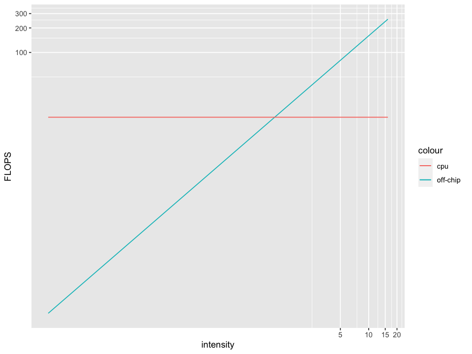
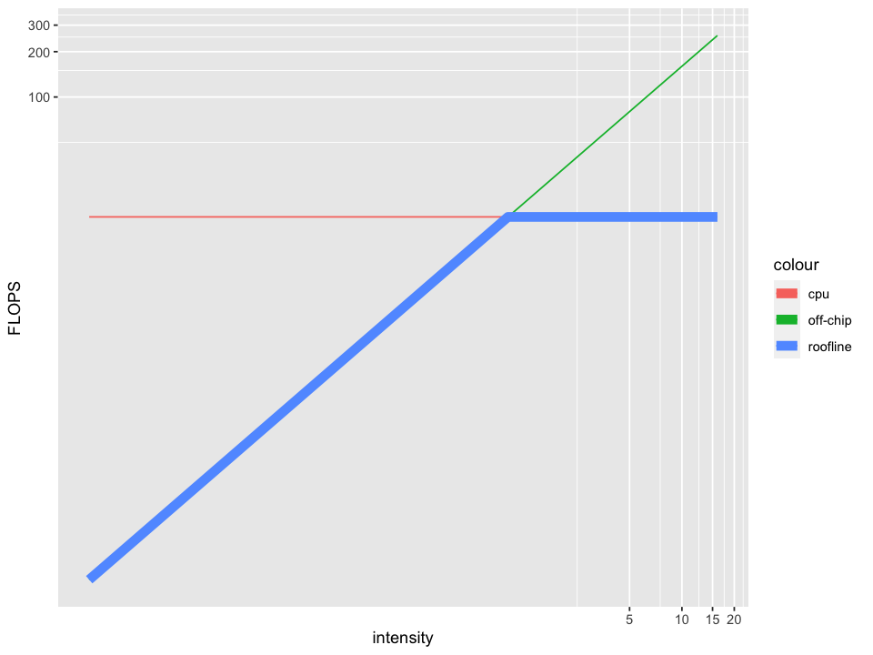
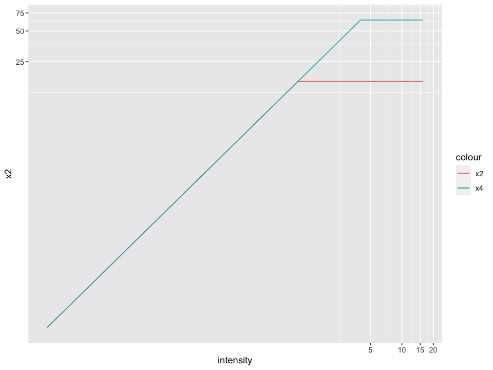

# Roofline

Learning goals:
  * State the roofline bound: performance is the smaller of the compute
    ceiling and bandwidth × arithmetic intensity
    * arithmetic intensity (AI): FLOP per byte moved from memory
    * the ridge point: the AI where the two ceilings meet
  * Use the roofline as a practical tool
    * measure the ceilings of your own machine
    * count the FLOP and bytes of a kernel, run it, and place it on the plot
    * read the plot: which ceiling bounds the kernel, and how far below it
      the kernel sits
  * Explain what the measured kernels show on one core and on all cores
    * memory-bound kernels sit on the slope, compute-bound kernels under a
      flat ceiling
    * the ceilings under the peak (scalar, SIMD, FMA) are the optimizations
      of Lectures 3 and 7
    * cores raise the compute ceiling but not the bandwidth ceiling, so the
      ridge point moves right

(This content was generated by Claude Opus 5.5 based on prior lectures from
Randal Burns and edited by Randal Burns.)


# Examples

  * [examples/roofline/](../examples/roofline/README.roofline.md) — a roofline for the Apple M5, measured, on one core and on all cores
    * [stream.cpp](../examples/roofline/roofline_example/stream.cpp), [peak_flops.cpp](../examples/roofline/roofline_example/peak_flops.cpp) — the bandwidth ceiling and four compute ceilings
    * [dot_bench.cpp](../examples/roofline/roofline_example/dot_bench.cpp), [saxpy_bench.cpp](../examples/roofline/roofline_example/saxpy_bench.cpp), [stencil_bench.cpp](../examples/roofline/roofline_example/stencil_bench.cpp), [spmv_bench.cpp](../examples/roofline/roofline_example/spmv_bench.cpp) — low-AI kernels
    * [nbody_bench.cpp](../examples/roofline/roofline_example/nbody_bench.cpp), [matmul_naive_bench.cpp](../examples/roofline/roofline_example/matmul_naive_bench.cpp) — high-AI kernels
    * [sort_bench.cpp](../examples/roofline/roofline_example/sort_bench.cpp) — a kernel that isn't FLOP
    * `*_mt.cpp` and [mt_common.hpp](../examples/roofline/roofline_example/mt_common.hpp) — the same kernels on every core
    * [roofline.py](../examples/roofline/roofline_example/roofline.py), [Makefile](../examples/roofline/roofline_example/Makefile) — `make plot` and `make plot_mt`

---

## Where this picks up

  * Lectures 3–8: using one core well — ILP, the memory hierarchy, loops,
    vectorization
  * Lectures 9–15: using many cores — threads, OpenMP, Cilk, sharing,
    synchronization
  * both raise the question: how fast *could* this code run? Is it worth
    parallelizing, or vectorizing, or is something else the limit?
  * the roofline answers it with two measurements of the machine and two
    counts of the code

## Part 1: the model

"We believe that for the recent past and foreseeable future, off-chip memory
bandwidth will often be the constraining resource. Hence, we want a model that
relates processor performance to off-chip memory traffic" (Williams, Waterman
and Patterson, 2009)

This was the crucial insight in 2009. Multicore computing was changing the mix
of resources. It became possible to deliver many more flops (in cores) without
increasing the off-core bandwidth.

### Concepts

The total number of $\text{FLOP}/\text{s}$ realized is bounded by either:
  * the amount of data delivered to the processor times the operational
    intensity $(\text{GB}/\text{s} \cdot \text{FLOP}/\text{GB} = \text{FLOP}/\text{s})$
  * the peak processing throughput of the processor

Operational intensity is a measure of how many times you use each byte. This
lecture calls it arithmetic intensity (AI): FLOP per byte moved from memory.
Graphically, these bounds look like:



  * `off-chip` BW is the amount of data transferred from memory to the
    processor

Taking the minimum of these functions describes the __roofline__. This is the
feasible region for a computation:
  * no possible program can exceed the roofline
  * inefficient programs may fall below the roofline

```r
intensity = 2^(-8:4)
offchip = 16  # GB/s
flopsmax = 16 # GFLOP/s

memband <- data.frame(intensity, intensity * offchip, flopsmax,
                      pmin(intensity * offchip, flopsmax))
colnames(memband) <- c("intensity", "FLOPS", "cpuFLOPS", "Roofline")
```



In one line:

```
GFLOP/s  ≤  min( peak GFLOP/s,  bandwidth (GB/s) × AI (FLOP/byte) )
```

The corner where the slope meets the flat line is the **ridge point**, at
AI = peak / bandwidth.

### Kernels

So, the idea is to measure a given program's operational intensity, which will
correspond to a vertical line on the plot. The peak of the roofline divides
the world into:
  1. memory-bound or
  2. CPU bound


### Effect of Multicore

Multicore processing has only made the situation worse. The paper gives the
example in which Intel added two cores and increased CPU speed without
changing the socket.
  * All memory bound programs perform the same
  * Some CPU bound programs become memory bound and realize only partial
    speedup (intensities 1.5–8)
  * Only the most dense programs see benefit

```r
flopsmax  = 16 # GFLOP/s
flopsmax2 = 64
memband <- data.frame(intensity, pmin(intensity * 16, flopsmax),
                      pmin(intensity * 16, flopsmax2))
```



Over time, processors grow faster than memories and all kernels become memory
bound!
  * This has happened progressively.

### Using Roofline to Optimize Code

* Use CPU ILP and multicore to raise peak.
  * pipeline parallelism (program independent instructions)
  * SIMD (vector instructions)
* Change operational intensity of program
  * unroll loops (increase compute density)
* Improve data movement to shift memory bound
  * sequential data access
  * coalesced data access

These are all pretty low-level, but exactly the same optimization trajectory
as we used for OpenMP.


Looking at the whole figure, we can see the structure of compute:
  * TLP == thread-level parallelism, use all threads
  * ILP == plus a bunch of stuff
    * pipelining
    * branch prediction
    * functional unit latency
  * SIMD -- we know what this is. vectorize computation
  * multiply/add balance -- processors do fused multiply-adds (a*x + b) in a
    single instruction when possible.

So, there are sub-rooflines that reveal structure that associate code
performance with optimization.

### Kernels Again

The authors picked 7 typical data-science/science codes and mapped their
kernels.


Observations:
  * These are well optimized -- the code performance lies near the roofline.
  * None of these codes has the operational intensity needed to reach peak

It is reasonable to conclude that we are designing processors incorrectly.
More attention should be paid to off-chip bandwidth.
  * You could eliminate a bunch of processing power (by core count or clock
    rate) and produce a lower-power chip that runs exactly as well.
  * This is 2009. The situation has only gotten worse. Roofline peaks go up
    and to the right.

### Co-Design Kernels and Processors

The best situation is when the kernel lies exactly at the corner of the
roofline.
  * farther right and lower off-chip bandwidth could realize the same
    performance
  * farther left and not enough bandwidth to realize max FLOP/s

This is optimal in terms of efficiency of hardware (use all resources
maximally) and, therefore, power.

Data-science kernels tend to not have enough operational intensity for CPUs.
What about ML?

### Relationship with GPU and ML

The goal of GPU optimization has always been to maximize memory bandwidth.
  * this assumes that you live in the memory bound domain
  * this has been largely true for scientific codes.
  * Operational intensity of <20

Training ML models has crazy high operational intensity. >100
  * Google made a compelling case for this in their TPU paper.
  * TPU has a peak at ~1000.

Let's look at the relationship between CPU, GPU, and TPU and operational
intensity to determine what applications are right for each architecture.
[https://arxiv.org/pdf/1704.04760.pdf](https://arxiv.org/pdf/1704.04760.pdf).

## Part 2: roofline as a practical tool

Part 1 used made-up numbers (16 GB/s, 16 GFLOP/s). The model is useful
because every piece of it can be measured on the machine in front of you.

### Measure the ceilings

  * bandwidth: [stream.cpp](../examples/roofline/roofline_example/stream.cpp)
    runs the STREAM kernels (copy, scale, add, triad) on arrays much larger
    than the cache and reports the best GB/s
  * compute: [peak_flops.cpp](../examples/roofline/roofline_example/peak_flops.cpp)
    runs 30 independent chains of one instruction, entirely in registers, no
    memory at all
    * 30 chains so the latency of each instruction is hidden (Lecture 3)
    * four versions, four ceilings: scalar or SIMD (Lecture 7), each with or
      without FMA
    * FMA (`a*b + c`, one instruction, 2 FLOP) doubles the peak; SIMD
      (4 floats per NEON instruction) quadruples it
  * the four ceilings are the optimizations: a kernel under the scalar line
    can't reach the peak without vectorizing, however good its memory access

### Place a kernel

  * count the FLOP and the bytes from the code, not from a profiler

    | kernel | FLOP | bytes | AI |
    |---|---|---|---:|
    | dot product | 2 per element | read `a[i]`, `b[i]`: 8 | 0.25 |
    | SAXPY `y = a*x + y` | 2 per element | read `x`, read and write `y`: 12 | 0.167 |
    | 7-point stencil | 8 per point | 7 reads + 1 write: 32 | 0.25 |
    | SpMV (CSR) | 2 per nonzero | value, column index, gathered `x`: 12 | 0.167 |
    | N-body, N = 4096 | 22 per pair, N² pairs | positions once: 16N | 5632 |
    | matmul, n = 512 | 2n³ | A, B, C once: 12n² | n/6 = 85.3 |

  * time it, and divide: GFLOP/s = FLOP / time
  * the byte count is a model, the compulsory traffic, not what the hardware
    actually moves
    * reuse in cache makes the real traffic lower, so a kernel can land
      *above* its line
    * the plot tells you when the model is wrong, which is itself useful
  * measuring honestly is most of the work
    * the compiler will remove a timed call whose result is unused, or
      merge repeated calls: an `asm volatile` barrier stops it
    * `dot_bench.cpp` once reported `inf` GFLOP/s because the compiler
      removed four of its five timed calls

### Read the plot

  * on the slope and near it: memory-bound and doing well; to go faster,
    raise the AI (reuse data, Lecture 6's tiling) or move fewer bytes
  * under a flat ceiling: compute-bound; the next ceiling up names the next
    optimization (vectorize, use FMA, add cores)
  * far below everything: neither ceiling is the limit; the kernel is
    bound by something the model doesn't describe — latency, branches, a
    serial section

## Part 3: one core

  * `cd examples/roofline/roofline_example; make plot`
  * Apple M5, one core, FP32: 116 GB/s, and 135 GFLOP/s with SIMD FMA; the
    ridge point is at AI ≈ 1.2

![Roofline for one core of an Apple M5, FP32, log-log axes. A bandwidth slope of 116.1 GB/s meets four flat compute ceilings: scalar mul-only 17.8, scalar FMA 30.1, SIMD mul-only 71.1, SIMD FMA 135.5 GFLOP/s. Kernels: SAXPY, dot product and the 7-point stencil sit on or near the slope at AI 0.17–0.25; SpMV sits far below it at 2.6 GFLOP/s; std::sort at AI 6.6 sits at 1.6, far below every ceiling; the four naive matmul variants at AI 85 each sit at or near their own ceiling; N-body at AI 5632 sits at 58 GFLOP/s, below the SIMD mul-only line](../examples/roofline/roofline_example/roofline.png)

| kernel | AI | GFLOP/s | where it sits |
|---|---:|---:|---|
| SAXPY 32M | 0.167 | 20.3 | on the slope: ~122 GB/s |
| dot product 32M | 0.25 | 20.9 | below the slope: ~84 GB/s, 72% |
| 7-pt stencil 256³ | 0.25 | 32.6 | *above* the slope: cache reuse |
| SpMV 4M × 7 | 0.167 | 2.6 | far below: ~15 GB/s, 13% |
| `std::sort` 16M | 6.6 | 1.6 | far below every ceiling |
| N-body 4096 | 5632 | 58.2 | compute-bound, 43% of peak |
| naive matmul, scalar | 85.3 | 17.4 | at the scalar ceiling (17.8) |
| naive matmul, scalar FMA | 85.3 | 32.1 | at the scalar FMA ceiling (30.1) |
| naive matmul, SIMD | 85.3 | 53.8 | 76% of the SIMD ceiling (71.1) |
| naive matmul, SIMD FMA | 85.3 | 120.2 | 89% of the peak (135.5) |

What the plot shows:

  * **the streaming kernels are memory-bound**: SAXPY and dot product sit at
    AI 0.17–0.25, far left of the ridge. Vectorizing them further or adding
    FMA can't help; they already run at most of the bandwidth
  * **the stencil is above its line**: its 32-byte count assumes every
    neighbor comes from memory, but `in[c-1]` and `in[c+1]` are in the same
    cache line as `in[c]`. The real AI is higher than the model's
  * **SpMV is far below its line**: the column indices are random, so each
    `x[col_idx[k]]` is a separate cache miss. The core can't keep enough of
    them in flight to use the bandwidth: the limit is memory **latency**,
    not bandwidth
  * **sort doesn't belong on a FLOP plot**: it is plotted as comparisons
    per second, and comparisons are branches and data movement, not
    floating-point work. It sits right of the ridge and far below the roof:
    the model has nothing to say about it
  * **matmul reaches each ceiling in turn**: the four variants are the same
    loop, scalar or SIMD, with or without FMA, and each lands at or near its
    own ceiling
    * getting there took register blocking: a 4 × 4 tile of C kept in
      registers for the whole k loop. This is Lecture 6's tiling one level
      down: the tile fits in the register file instead of L1
    * without blocking, the SIMD versions were bound by L1 bandwidth; with a
      1-column tile, SIMD FMA measured *slower* than SIMD mul + add, because
      each B load fed only one FMA
  * **N-body is compute-bound but under the peak**: only 6 of the ~16 SIMD
    instructions per pair are FMAs; the rest are subtracts, multiplies and
    the reciprocal-square-root steps. The peak assumes every instruction is
    an FMA, so N-body's real ceiling is between the mul-only line and the
    peak
  * **BLAS `sgemm` is not plotted**: Accelerate runs it on the M5's AMX
    matrix unit, not on the NEON pipeline `peak_flops.cpp` measures. It
    beats these ceilings because it uses different hardware
    ([matmul_bench.cpp](../examples/roofline/roofline_example/matmul_bench.cpp))

## Part 4: every core

  * `make plot_mt`: each `_mt` kernel splits its work into one contiguous
    range per thread, 10 threads on 10 cores
    ([mt_common.hpp](../examples/roofline/roofline_example/mt_common.hpp))
  * the ceilings are measured again with every core running:
    [stream_mt.cpp](../examples/roofline/roofline_example/stream_mt.cpp),
    [peak_flops_mt.cpp](../examples/roofline/roofline_example/peak_flops_mt.cpp)


| | AI | 1 core | 10 cores | speedup |
|---|---:|---:|---:|---:|
| bandwidth (GB/s) | | 116.1 | 125.6 | **1.08×** |
| SIMD FMA peak | | 135.5 | 889.5 | **6.6×** |
| SAXPY 32M | 0.167 | 20.3 | 21.4 | 1.05× |
| `std::sort` 16M | 6.6 | 1.6 | 2.1 | 1.36× |
| dot product 32M | 0.25 | 20.9 | 32.5 | 1.56× |
| SpMV 4M × 7 | 0.167 | 2.6 | 4.9 | 1.9× |
| 7-pt stencil 256³ | 0.25 | 32.6 | 72.7 | 2.2× |
| naive matmul, SIMD FMA | 85.3 | 120.2 | 403.9 | 3.4× |
| N-body 4096 | 5632 | 58.2 | 251.2 | 4.3× |

Part 1's multicore claim, measured:

  * **the compute ceiling scales and the bandwidth ceiling doesn't**: 6.6×
    more GFLOP/s, 1.08× more GB/s. The ridge point moves from AI ≈ 1.2 to
    AI ≈ 7
  * **one core nearly saturates the memory system**: one M5 core gets 116
    of the 126 GB/s. SAXPY, a pure stream, gets nothing from 9 more cores
  * **memory-bound doesn't mean no speedup**, it means no speedup past
    the bandwidth
    * dot product was at 72% of the bandwidth on one core; 10 cores take it
      to the line
    * SpMV was latency-bound: 10 cores keep 10 times as many misses in
      flight, so it nearly doubles, though it is still far below the line
    * the stencil's cache reuse lets it scale past the plain streams
  * **compute-bound kernels scale, but not 10×**: 6 of the 10 cores are
    efficiency cores, each with a fraction of a performance core's
    throughput, so even the peak is 6.6×, not 10×
  * **matmul falls behind its ceiling**: 89% of the peak on one core, 45%
    on ten. Its ceiling moved; something else became the limit
  * **sort is Amdahl's law**: `std::sort` has no threads, so
    [sort_bench_mt.cpp](../examples/roofline/roofline_example/sort_bench_mt.cpp)
    sorts one chunk per thread and then merges the chunks on one thread.
    The serial merge holds it to 1.36×
  * the lesson for parallelizing: check where the kernel sits *before*
    adding threads. Left of the multicore ridge, threads buy little; the
    work is to raise the AI

## What to carry forward

  * two measurements of the machine (bandwidth, peak) and two counts of the
    code (FLOP, bytes) bound how fast any kernel can run
  * the ceilings under the peak are the single-core optimizations; cores
    are one more ceiling, and only for kernels right of the ridge
  * a kernel that lands off the model — above its line, or far below
    everything — is telling you the byte count or the bottleneck is wrong

## On Your Own

  * run `make plot` and `make plot_mt` in
    [examples/roofline/roofline_example/](../examples/roofline/roofline_example/);
    do your numbers match these? run it twice: do they match each other?
  * compute the AI of `c[i] = a[i] + b[i]` in FP32 and in FP64. Where does
    each sit on the M5's single-core roofline, and what GFLOP/s do you
    predict?
  * SpMV with a *banded* matrix (column indices near the row index) has the
    same AI. Where do you expect it to land, and why?
  * on ten cores, naive SIMD FMA matmul reaches 45% of its ceiling. Its
    3 MB working set fits in the shared cache. Which ceiling is missing from
    the plot?
