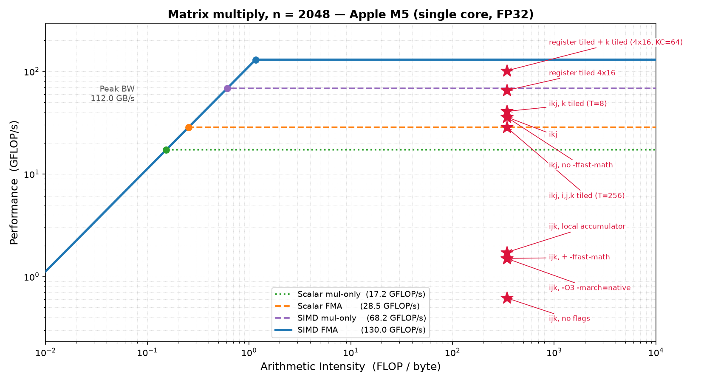

# Matrix Multiplication

Learning goals:
  * Follow one small program, matrix multiply, as it gets 200 times faster,
    and say what was slowing it down at each step
    * compiler flags: turn on optimization and the machine's vector
      instructions
    * loop order: which matrix the inner loop walks through, and how
    * tiling: keep the data you reuse in a cache, or in registers
  * Connect each step to the lecture where we first saw the idea
    * cache lines and stride (Lecture 5), loop interchange and tiling
      (Lecture 6), vectorization and FMA (Lecture 7), independent chains
      (Lecture 3), aliasing (Lecture 4), the roofline (Lecture 16)
  * Work out the fastest a core could possibly go, and measure how far each
    version is from it
  * Explain why a multithreaded matrix multiply gives each thread its own
    part of the output C
    * threads can all read the same data for free, but they cannot all
      write the same data for free
  * Know what a math library (BLAS) and special matrix hardware do beyond
    what we do here

(This content was generated by Claude Fable 5.2 based on prior lectures from
Randal Burns and edited by Randal Burns.)


# Reading

  * Si Boehm, [Fast Multidimensional Matrix Multiplication on CPU from
    Scratch](https://siboehm.com/articles/22/Fast-MMM-on-CPU) (2022). We
    present it in class. This outline follows it section by section and
    connects each step to earlier lectures

# Examples

The blog has no code repository; its code is in the article. These are our
versions of the same steps:

  * [examples/matmul/](../examples/matmul/) — the blog's kernels on one M5 core, 32-bit floats, n = 1024 and 2048, plotted on the roofline
    * [mm_bench.cpp](../examples/matmul/mm_bench.cpp) — `ijk`, `ijk_local`, `ikj`, `tile_k<T>`, `tile_ijk<T>`, and the register-tiled `reg<M>x<R>`
    * [plot_mm.py](../examples/matmul/plot_mm.py), [Makefile](../examples/matmul/Makefile) — `make plot`
    * [mm_mt.cpp](../examples/matmul/mm_mt.cpp) — the multithreaded versions; `make run_mt`
    * [register_tiling.html](../examples/matmul/register_tiling.html) — a page on register tiling, with every measurement (open it in a browser)
    * [loop_order_stepper.html](../examples/matmul/loop_order_stepper.html) — step `i,k,j` and the register-tiled kernel side by side and see where C lives while it is summed (also [online](https://claude.ai/artifact/S9KRnhAjncZr9MqoaNMwot))
    * [why_split_c.html](../examples/matmul/why_split_c.html) — a page on why threads split the output C and not the inputs A and B (also [online](https://claude.ai/artifact/3EMhpxRJp1o5FxcqTAs8Wh))
    * [strips_or_squares.html](../examples/matmul/strips_or_squares.html) — a page on dividing C among threads in strips or squares, with the read ratios drawn out (also [online](https://claude.ai/artifact/Hs9nbPE7ybT3JTgbHFKQ1d))
    * [matrix_units.html](../examples/matmul/matrix_units.html) — a page on hardware built for matrix multiply: Apple, Intel, AMD and NVIDIA (also [online](https://claude.ai/artifact/1DyByRendx3fjEjwn3t7q6))
    * [sme/](../examples/matmul/sme/README.sme.md) — add-on: the multiply written for the M5's matrix unit with Arm SME, and [packing.html](../examples/matmul/sme/packing.html), a page on packing (also [online](https://claude.ai/artifact/9YQWB8xvsKbSSA1D2MzFHA))
  * [examples/loop_optimizations/matmul_tiling.cpp](../examples/loop_optimizations/matmul_tiling.cpp) and [matmul_tiling.md](../examples/loop_optimizations/matmul_tiling.md) — `i,j,k`, `i,k,j`, then tiling (Lecture 6)
  * [examples/roofline/roofline_example/matmul_naive_bench.cpp](../examples/roofline/roofline_example/matmul_naive_bench.cpp) — a register-tiled kernel from Lecture 16
  * [examples/roofline/roofline_example/matmul_bench.cpp](../examples/roofline/roofline_example/matmul_bench.cpp) — the library's `sgemm`, to compare against

---

## Where this picks up

  * Lecture 6 used matrix multiply as the example of **reuse**: the work
    grows as N³ but the data only as N², so every number is used N times
  * Lecture 16 put matrix multiply at the far right of the roofline. It
    does a lot of arithmetic per byte of data, so it should be limited by
    the processor, not by memory
  * the blog asks a practical question: starting from the three-line loop,
    how close can plain C++ get to a professional library, and what does
    each step buy?
  * we run the same steps on a different machine. Where our numbers
    disagree with the blog's, the reason is worth finding

## The machine and the target

  * the blog's machine: Intel i7-6700, 3.4 GHz, 4 cores. Caches: 32 KB L1,
    256 KB L2 per core, 8 MB shared L3. Its vector registers (AVX2) hold 8
    floats
  * the problem: multiply two 1024 × 1024 matrices of 32-bit floats. That
    is about 2.1 billion floating-point operations (2n³). Each matrix is
    4 MB
  * the target: NumPy, which calls Intel's MKL library, does it in 8 ms on
    4 cores

### The peak: the most one core can do

The blog works out that one core can do at most 32 floating-point
operations (FLOPs) per cycle. Each number in the product is something we
have seen:

| term | value | where we met it |
|---|---|---|
| floats per vector register | 8 | Lecture 7: what a vector is |
| FLOPs per FMA | 2 | an FMA does a multiply and an add in one instruction (Lecture 16) |
| FMAs started per cycle | 2 | Lecture 3: throughput |
| **peak** | 8 × 2 × 2 = **32 FLOPs per cycle** | about 109 GFLOP/s per core at 3.4 GHz |

  * no real program reaches the peak, but it tells us how much room is
    left
  * MKL gets about 18 of the 32. The blog's best single-core code gets
    about 9
  * our M5 has a higher peak: 130 GFLOP/s per core, measured in Lecture 16

## Step 1: the simple loop, and compiler flags

  * the simple loop is three nested loops in the order `i, j, k`
    ([mm_bench.cpp](../examples/matmul/mm_bench.cpp), `mm_ijk`)
  * with no flags it takes 4.5 s on the blog's machine. That is 0.4% of
    the peak
  * three flags make it 2.8× faster, and each one is from an earlier
    lecture:
    * `-O3` turns on optimization, including vectorization. Lecture 6's
      warning: check that the loop was vectorized before you conclude
      anything about memory
    * `-march=native` lets the compiler use this machine's newest
      instructions. Without it, the compiler targets the oldest machines
      and cannot use AVX2 or FMA at all (Lecture 7)
    * `-ffast-math` lets the compiler change the order of floating-point
      additions. The inner loop of `i,j,k` adds up one long sum. To
      vectorize a sum, the compiler has to split it into several partial
      sums and combine them at the end. That changes the rounding, so the
      compiler needs permission (Lectures 6 and 7)
  * adding into a local variable instead of `C[i][j]` gains another 7%.
    The compiler can keep a local in a register. It can't do that for
    `C[i][j]`, because it can't prove that C doesn't overlap A or B
    (aliasing, Lecture 4)
  * ask in class: why does `-ffast-math` matter for `i,j,k` and stop
    mattering after the next step?

## Step 2: loop order

  * swap the two inner loops: `i, k, j`. The blog's time drops from 1.5 s
    to 89 ms, 17× faster, from changing one line
  * this is loop interchange from Lecture 6. It helps for two reasons

**Reason 1: the inner loop reads memory in order.**
  * in `i,j,k` the inner loop walks *down a column* of B. Each step jumps
    4 KB ahead in memory and uses one float from each cache line it
    touches (Lecture 5)
  * in `i,k,j` the inner loop walks *along a row* of B and of C. It uses
    all 16 floats in every cache line, and the hardware prefetcher can see
    where it is going

**Reason 2: the inner loop is no longer one long sum.**
  * `i,k,j` does `C[i][j] += A[i][k] * B[k][j]` for each j. Each step
    updates a *different* element of C, so the steps don't depend on each
    other. The compiler can do 8 of them at once
  * each `C[i][j]` still gets its additions in the same order as before,
    one for each k. Vectorizing across j changes no result
  * in `i,j,k`, vectorizing would split one sum into 8 partial sums. That
    does change the order of the additions, which is why it needed
    `-ffast-math`
  * so `i,k,j` vectorizes without `-ffast-math`. That answers the question
    from Step 1

  * check against the peak: 89 ms is about 24 GFLOP/s, 22% of what one
    core can do. Much faster, and still far from the limit

## Step 3: tiling

  * the blog splits the k loop into blocks of T. The loops become: for
    each block of k, for each i, for each k in the block, for each j
  * this is tiling from Lecture 6. The first question there is the right
    one here: **what data gets reused?**
    * in `i,k,j`, every row of A uses all of B. B is 4 MB and doesn't fit
      in the blog machine's L2, so B is fetched from L3 again for every
      row: 1024 times
    * with k in blocks of T, the same T rows of B are used by every row of
      A before moving on. Those T rows stay in a fast cache
  * the blog's formula says the best tile size is about 3.5. Trying every
    size finds that 16 is best: 89 ms → 70 ms
    * Lecture 6 found the same thing with transpose: formulas pick the
      wrong tile. **Try a range of tile sizes and measure. Don't
      calculate it**

## Step 4: tiling every loop

  * the blog also tiles i and j, and finds it helps very little at
    n = 1024
  * Lecture 6 measured the same thing on our Zen 5 machine
    ([matmul_tiling.md](../examples/loop_optimizations/matmul_tiling.md)):
    tiling all three loops gave 1.2–1.3× while the matrices fit in the L3
    cache, and 3.0× at n = 2048 when they didn't
  * the reason: tiling cuts the amount of data pulled from memory. That
    only matters when memory was the limit, so tiling helps more as the
    matrices get bigger

## On the roofline

  * code: [examples/matmul/](../examples/matmul/). Every kernel from this
    lecture on one core of the M5, at n = 1024 and n = 2048. `make plot`
    draws one roofline for each size




### Why all the points line up, and why 2048 is further right

**Arithmetic intensity (AI)** is FLOPs per byte of data moved (Lecture 16).
Count both for C = A × B with n × n matrices of 32-bit floats:

| | count | n = 1024 | n = 2048 |
|---|---|---:|---:|
| FLOPs | 2n³: n³ multiplies and n³ adds | 2.1 billion | 17.2 billion |
| bytes | 3n² × 4: read A and B, write C, once each | 12 MB | 48 MB |
| **AI** | 2n³ / 12n² = **n/6** | **171** | **341** |

  * every kernel does the same arithmetic on the same data, so they all
    have the same AI and sit on one vertical line
  * work grows as n³ and data as n², so the AI grows with n. Double n and
    the AI doubles
  * both sizes are far to the right of the M5's ridge point (AI ≈ 1.2).
    The roofline says matrix multiply *can* run at the processor's peak

### The AI on the plot is the best case

  * n/6 assumes each matrix is read from memory once. That only happens if
    the code keeps the data it reuses in cache
  * plain `ikj` doesn't. For every row of A it reads all of B again
    * B is read n times: n × n² floats × 4 bytes = 4n³ bytes
    * its real AI is 2n³ / 4n³ = **0.5 FLOPs per byte, at any n**
  * does that hurt? Look at the roof at the *real* AI
    * at AI 0.5, the M5's memory (112 GB/s) allows 0.5 × 112 = 56 GFLOP/s
    * `ikj` runs at 36, which is under that. So on the M5, re-reading B is
      not what limits `ikj`, even at n = 2048
  * measured: `ikj` runs at the same speed at both sizes, and tiling k
    helps only a little at both

    | kernel | n = 1024 | n = 2048 |
    |---|---:|---:|
    | `ijk`, no flags | 0.67 | 0.62 |
    | `ijk`, `-O3 -march=native` | 1.96 | 1.50 |
    | `ijk`, + `-ffast-math` | 1.96 | 1.50 |
    | `ijk`, local accumulator | 1.91 | 1.72 |
    | `ikj` | 36.0 | 35.9 |
    | `ikj`, k tiled (best T) | 43.0 (T=16) | 40.7 (T=8) |
    | `ikj`, i,j,k tiled (best T) | 31.3 (T=256) | 28.4 (T=256) |
    | register tiled, 4 × 16 (Step 5) | 105.1 | 65.2 |
    | register tiled + k tiled (Step 5) | **113.6** | **101.4** |

    GFLOP/s, one M5 performance core. The peak is 130 GFLOP/s
  * on the Zen 5 machine in Lecture 6, memory is slower (39 GB/s) and the
    untiled loop ran right at the memory roof. There, tiling won 3×.
    **Tiling for cache pays off when memory is what limits the loop**
  * a point's height below the roof shows how much of the possible speed
    the *code* failed to get

### What the M5 numbers say

  * `-ffast-math` adds nothing on the M5. Clang doesn't vectorize the
    `ijk` sum even when it is allowed to. The flag that vectorized the
    loop on the blog's machine does nothing here
  * `ikj` is the big step: 18× at n = 1024 and 24× at n = 2048, with or
    without `-ffast-math`
  * tiling all three loops is *slower* than plain `ikj` at every tile
    size. With small tiles the inner loop is too short to keep the vector
    unit busy
  * the best of these reaches 33% of the peak. Each FMA in the `ikj` inner
    loop needs to load B, load C and store C. Loading and storing, not
    arithmetic, sets the pace. The next step fixes that

## Step 5: register tiling

The blog stops before this step. It is the first thing a math library does,
and it gets us from 33% to 87% of the peak.

  * page with diagrams and every measurement:
    [register_tiling.html](../examples/matmul/register_tiling.html)
  * step it next to `i,k,j` and watch which loads and stores disappear:
    [loop_order_stepper.html](../examples/matmul/loop_order_stepper.html)
  * code: `mm_reg` in [mm_bench.cpp](../examples/matmul/mm_bench.cpp);
    `make run_reg`

### The idea

  * tiling for cache keeps reused data in a *cache*. Register tiling keeps
    it in *registers*, the fastest storage there is
  * keep a small block of C, say 4 rows × 16 columns, in registers for the
    whole k loop
  * each step of k loads 4 numbers from A and 16 from B, and does 64
    multiply-adds with them. Every number loaded is used many times
  * C is loaded once before the k loop and stored once after it, not once
    per multiply

```cpp
for (i in steps of 4)
    for (j in steps of 16) {
        float acc[4][16];                   // the compiler keeps this in registers
        /* load acc from C */
        for (k = 0; k < N; k++)
            for (r = 0; r < 4; r++)
                for (c = 0; c < 16; c++)
                    acc[r][c] += A[i + r][k] * B[k][j + c];
        /* store acc to C */
    }
```

### How big should the block be?

GFLOP/s at n = 1024 for different block shapes. A NEON register holds 4
floats, so a 4 × 16 block uses 16 registers:

| block | 4×4 | 1×16 | 2×16 | 4×8 | 4×16 | 8×8 | 8×16 | 16×16 |
|---|---:|---:|---:|---:|---:|---:|---:|---:|
| registers for C | 4 | 4 | 8 | 8 | 16 | 16 | 32 | 64 |
| GFLOP/s | 31.8 | 29.3 | 58.8 | 62.5 | **105.1** | 104.5 | 81.1 | 53.3 |

  * **too small is slow.** The core can start 4 FMAs every cycle, and each
    takes about 4 cycles to finish. An FMA that adds into a register has to
    wait for the previous FMA on that register. To keep the core busy we
    need 4 × 4 = 16 registers being added into at once. This is the
    independent-chains idea from Lecture 3
    * 4 registers: about a quarter of the peak. 8: about half. 16: about
      80%
  * **too big is slow.** The M5 has 32 vector registers. An 8 × 16 block
    needs 32 for C and more for B. They don't fit, so the compiler keeps
    some of the block in memory, which is what we were trying to avoid
  * 4 × 16 and 8 × 8 are the right size: 16 registers for C, with room
    left for A and B

### Bigger matrices need both kinds of tiling

| | n = 1024 | n = 2048 |
|---|---:|---:|
| `ikj` | 35.9 | 35.4 |
| register tiled 4 × 16 | 105.1 | 65.2 |
| register tiled 4 × 16, k in blocks of 64 | **113.6** | **101.4** |

  * at n = 1024, all of B (4 MB) fits in the M5's 16 MB L2 cache, so
    register tiling alone is enough
  * at n = 2048, B is 16 MB and doesn't fit. Register tiling alone drops
    to 65 GFLOP/s, because B has to be fetched from memory again and again
  * tiling k (Step 3) keeps a small part of B in the cache. Together they
    reach 101 GFLOP/s. Register tiling made the arithmetic fast enough that
    memory became the limit, and then cache tiling mattered

### Check what the compiler did

  * for the 8 × 8 block, clang first vectorized the wrong loop. The result
    ran at 39 GFLOP/s instead of 107
  * one line fixed it: `#pragma clang loop vectorize(disable)` on the k
    loop
  * the lesson from Lecture 6 again: when a number looks wrong, look at
    what the compiler produced before you explain it some other way

## Beyond registers: the matrix unit

Register tiling keeps a block of C in 16 registers and updates all of it
from a few loaded numbers. Chip makers have built that idea into hardware.
This section comes before multithreading because it is the same step taken
further: still one thread, still reuse.

### Matrix units

  * page: [matrix_units.html](../examples/matmul/matrix_units.html)
    ([online](https://claude.ai/artifact/1DyByRendx3fjEjwn3t7q6))
  * a **matrix unit** is hardware inside the processor built for matrix
    multiply. It keeps a block of the result inside itself, and one
    instruction updates the whole block
  * the M5 has one. Apple's math library uses it, and one thread reaches
    1,850 GFLOP/s at n = 2048: 18 times our best kernel at that size, and
    14 times the 130 GFLOP/s "peak" we have been using. That peak was for
    ordinary vector instructions only
  * Intel has a similar unit in its server chips (AMX). AMD has none yet.
    NVIDIA builds the same idea into its GPUs (Tensor Cores)
  * no unit adds up a whole sum in one instruction. Each instruction adds
    a few terms of the sum over k to every number in the block, and a loop
    repeats it: the loop of Step 5, with more work done per step

### Writing for the matrix unit: SME

The matrix unit is not only for libraries. SME is Arm's instruction set for
it, and any program can use it on an M4 or later.

  * code and results: [examples/matmul/sme/](../examples/matmul/sme/README.sme.md)
  * one instruction, `FMOPA`, takes two vectors of 16 floats and adds every
    product `a[r] * b[c]` into a 16 × 16 **tile** kept inside the unit: 256
    multiply-adds
  * for C = A × B, one step of k is one `FMOPA` per block of C: a column of
    A times a row of B. It is the loop from Step 5, with a tile in place of
    `acc`
  * there are four tiles, and they are independent, like the 16 registers
    of Step 5. The unit's peak is 540, 1,080 and 2,160 GFLOP/s with 1, 2
    and 4 tiles

### Packing: feeding the matrix unit

A row of B is 16 numbers side by side. A column of A is not: its numbers
are a whole row apart, and the unit cannot gather them.

  * page with figures:
    [packing.html](../examples/matmul/sme/packing.html)
    ([online](https://claude.ai/artifact/9YQWB8xvsKbSSA1D2MzFHA))
  * transposing all of A first works, but the unit is so fast that the
    transpose is no longer small: at n = 2048 it takes 11.1 ms, and the
    best whole multiply takes 10.1 ms
  * **packing** fixes it: copy only the part of A and B about to be used
    into small buffers, in the order the kernel reads them. The unit can
    do the transposing itself, by loading a tile by rows and storing it by
    columns

| GFLOP/s, one thread | n = 1024 | n = 2048 |
|---|---:|---:|
| register tiled, NEON (Step 5) | 114 | 101 |
| SME, one tile, A transposed first | 482 | 158–218 |
| SME, four tiles, A transposed first | 1,386 | 412–486 |
| SME, four tiles, packed | **1,866** | **1,696** |
| Apple's library | 1,817 | about 1,860 |

  * packing is worth 1.3× at n = 1024 and 3.5× at n = 2048
  * with it, a kernel of about 60 lines of C++ matches Apple's library at
    n = 1024 on one thread
  * the cores share the matrix unit, so more threads add little: Apple's
    library gains 15% from using all of them. The multithreading in the
    next step is for the ordinary vector kernels

## Step 6: multithreading — give each thread part of the output

  * the blog's last step splits C into 256 × 256 tiles and runs them on 8
    threads with OpenMP: 16 ms, within 2× of MKL
  * the blog says in one sentence why it splits C and not k: splitting k
    would need atomics or locks. This section gives the full argument
  * code: [mm_mt.cpp](../examples/matmul/mm_mt.cpp); `make run_mt`
  * we use 1, 2 and 4 threads on the M5's 4 performance cores, with the
    work divided evenly. Which thread runs on which core is next lecture's
    subject

### Two ways to split C = A × B

  * page with figures for this section and the next:
    [why_split_c.html](../examples/matmul/why_split_c.html)
    ([online](https://claude.ai/artifact/3EMhpxRJp1o5FxcqTAs8Wh))

Every element of C is a sum over k: `C[i][j] = Σ_k A[i][k] · B[k][j]`.
There are two ways to divide the work.

  * **split the output**: each thread gets some rows of C
    * it reads its rows of A and *all* of B
    * it writes only its own rows of C. Each element of C is computed from
      start to finish by one thread
  * **split the sum**: each thread gets a range of k
    * it reads only its own part of A and B
    * but it computes only *part* of the sum for *every* element of C
    * every element of C needs a piece from every thread, so the threads
      have to combine their results

The two differ in what gets duplicated:

| | split C | split k |
|---|---|---|
| reads of B | every thread reads all of B | each thread reads its own part |
| writes to C | each element written by one thread | each element written by every thread |
| synchronization | none | atomics, or private copies and a merge |
| extra memory | none | none (atomics) or a copy of C per thread |
| result | exactly the same as one thread | depends on the order the pieces are added |

### Why split C



**1. No two threads write the same data, so there is nothing to
synchronize.**
  * a race needs two threads using the same data, with at least one
    writing (Lecture 14). Here A and B are only read, and each element of
    C has one writer
  * no locks, no atomics, no waiting. This is Lecture 14's best kind of
    synchronization: the kind you don't need

**2. Sharing reads is free. Sharing writes is not.**
  * every thread reads all of B. Data that is only read can sit in every
    core's cache at the same time, and nothing ever has to be updated
    (Lecture 13)
  * splitting k makes every thread *write* every part of C. A cache line
    that several cores write has to move back and forth between them.
    That is true sharing from Lecture 13, and it is slow

**3. Every way of combining the pieces costs something.**
  * *an atomic add for every term*: n³ atomic operations. Each one is a
    small retry loop, and a loop like that can't be vectorized, so this is
    12× slower even on one thread
  * *add up a row privately, then add it into C atomically*: far fewer
    atomics, but each one still has to wait for its cache line to arrive
    from another core. At n = 1024 it gets slower from 2 threads to 4
  * *a private copy of C for each thread, added together at the end*: no
    atomics. This is what OpenMP's `reduction` does. It costs a full copy
    of C per thread (64 MB at n = 2048 on 4 threads) and every thread
    writes a whole matrix
  * the combining work grows with the number of threads, while each
    thread's share of the multiply shrinks. Splitting k gets relatively
    worse as you add cores

**4. The same answer every run.**
  * floating-point addition gives slightly different results in different
    orders (Lecture 6). Splitting C adds each element's terms in the
    original order, so the result is identical to the one-thread program
  * splitting k adds the pieces in a different order. With atomics the
    order depends on timing, so the last digits change from run to run

**5. Each thread gets a complete, smaller matrix multiply.**
  * a band of rows of C is a matrix multiply of its own. Everything from
    Steps 1–5 works on it unchanged
  * measured on the M5's 4 performance cores: 3.1–3.2× with plain `ikj`,
    and 135–146 GFLOP/s at n = 1024 with the k-tiled loop

### When splitting k is right

  * when C is tiny but the sum is long. A 64 × 64 output with a million
    terms in each sum doesn't have enough output to share among cores, but
    has plenty of k. GPU libraries do this and call it *split-K*
  * the rule: split the output while that gives every core enough work.
    Split the sum only when it doesn't

### Which shape: rows, columns or squares

  * page with figures for this section:
    [strips_or_squares.html](../examples/matmul/strips_or_squares.html)
    ([online](https://claude.ai/artifact/Hs9nbPE7ybT3JTgbHFKQ1d))

Any way of dividing C is free of races. The choice is about how much data
each thread has to read. All of these use the k-tiled kernel:

  * **rows**: each thread gets n/p full rows of C (`c_rows_tiled`)
  * **columns**: each thread gets n/p full columns (`c_cols_tiled`)
  * **squares**: each thread gets one block of a 2 × 2 grid
    (`c_square_tiled`)
  * **the blog's tiles**: 256 × 256 tiles handed out in turn
    (`c_tiles256`)

What each thread reads on 4 threads, in units of one matrix (n² floats):

| | of A | of B | per thread |
|---|---|---|---:|
| rows | a quarter | all | 1.25 |
| columns | all | a quarter | 1.25 |
| squares | half | half | 1.0 |
| 256 × 256 tiles | re-read for every tile | re-read for every tile | 2 to 4 |

  * a thread computes an area of C and reads the rows of A and columns of
    B along its two edges. For the same area, a square has the shortest
    edges, so squares read the least

Measured, GFLOP/s on 4 performance cores, range over 5 runs:

| | n = 1024 | n = 2048 |
|---|---:|---:|
| rows | **137.6–146.4** | **114.4–121.5** |
| squares | 130.7–139.9 | 106.1–112.9 |
| columns | 130.7–136.5 | 101.9–112.2 |
| 256 × 256 tiles | 126.8–130.8 | 100.2–107.2 |

  * **the blog's tiles are slowest**, as the read count predicts: they
    read A and B again for every tile
  * **rows beat squares**, the opposite of the read count, in 9 of 10
    runs. A likely reason, not measured: the M5's four performance cores
    share one L2 cache. With rows, all four threads read the same part of
    B at the same time, so one copy in the cache serves all of them
  * the read count barely separates the shapes on 4 threads (1.25 against
    1.0). The difference grows with more cores, and matters most when
    cores don't share a cache. Where threads run and what they share is
    next lecture

## What a library does beyond this

The blog's best single-core code reaches about 28% of its machine's peak.
MKL reaches more than half. With register tiling we reach 87% on the M5.
What else does a BLAS library do?

  * **register tiling** (Step 5), with the inner block written by hand in
    assembly so the compiler can't get it wrong
  * **a tile for each cache level**: blocks sized for L1, L2 and L3
  * **packing**: copy each block of A and B into a small buffer in exactly
    the order the inner loop reads it. Every read is then sequential. We
    did this for the matrix unit above; libraries do it for ordinary
    vector code too
  * **a different kernel for each processor**: the library checks what
    chip it is running on and picks code written for it
  * **special hardware**: where the chip has a matrix unit, the library
    uses it, as Apple's does (see the matrix unit section above)

Faster *algorithms* such as Strassen's do fewer multiplications, but they
have large overheads and worse rounding. BLAS libraries don't use them.

## Reading the blog's numbers critically

  * the blog's matrix size is fixed when the program is compiled, so the
    compiler knows every loop count. A library has to handle any size.
    That makes the hand-written code look better than it is, as the blog
    says
  * NumPy's 8 ms includes Python overhead and starting its threads, so MKL
    itself is faster still
  * the blog reports milliseconds. Convert to GFLOP/s and to percent of
    peak. A 17× step and a 1.3× step look different once you see how far
    each leaves the code from the limit

## What to carry forward

  * the order of the steps is the order of the bottlenecks: let the
    compiler vectorize, read memory in order, then reuse what you load
  * every step used an idea we already had. The work is finding out what
    the loop is short of
  * reuse is the common thread: tiling reuses data in a cache, register
    tiling reuses it in registers, and matrix hardware builds that reuse
    into one instruction
  * the roofline says matrix multiply *can* run at the peak. The loop order
    and the tiles decide whether it *does*
  * to use many threads, split the output: threads can share reads for
    free, but not writes

## On Your Own

  * convert every row of the blog's results table to GFLOP/s and to percent
    of the 109 GFLOP/s single-core peak. Which step moves the code the
    furthest toward the limit?
  * run `make plot` in [examples/matmul/](../examples/matmul/). Does
    `ijk` → `ikj` give the blog's 17×? Close other programs first: if
    another program is using the fast cores, the benchmark runs on a slow
    core at half the speed
  * build `mm_bench.cpp` with and without `-ffast-math` and ask the
    compiler what it vectorized: `-Rpass=loop-vectorize` (clang) or
    `-fopt-info-vec` (GCC). Compare `ijk` and `ikj`
  * the blog's best tile is T = 16. How many bytes of B does that keep in
    use? Which cache on the i7-6700 does it fit in?
  * run `make run_reg`. Which block shape is fastest on your machine? How
    many vector registers does your processor have, and how many floats
    does each hold? Predict the best shape before you run it
  * for n = 2048 on 4 threads, work out what splitting k with private
    copies costs beyond splitting C: extra memory, extra writes, and the
    bytes read by the final merge. Then test it:
    [mm_mt.cpp](../examples/matmul/mm_mt.cpp) has the split-k versions
    (`k_atomic`, `k_atomic_row`, `k_private`). Run them at 1, 2 and 4
    threads against `c_rows`. Which one scales worst?
  * the M5's peak is about 135 GFLOP/s per core (Lecture 16). What is the
    shortest time one M5 core could take on the blog's problem?
