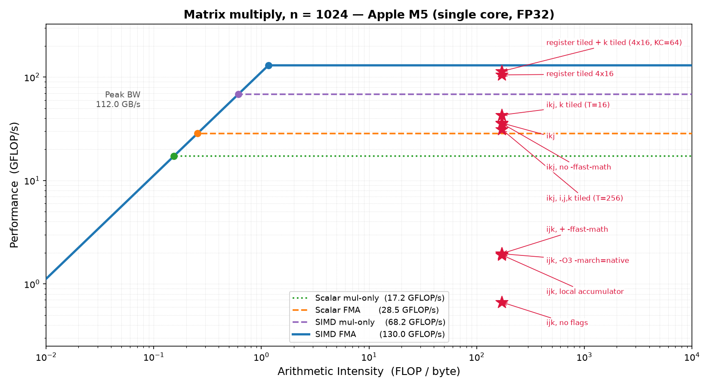
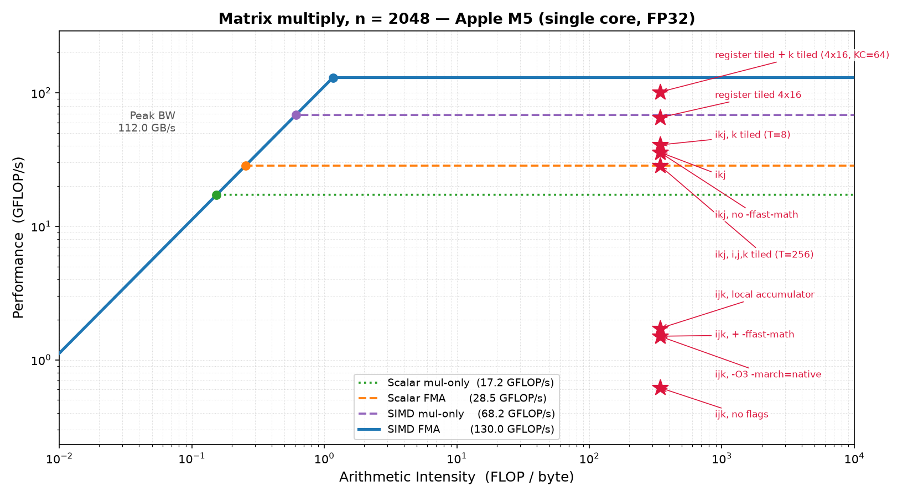

# Matrix Multiply, Step by Step

The kernels from Si Boehm's [Fast Multidimensional Matrix Multiplication on
CPU from Scratch](https://siboehm.com/articles/22/Fast-MMM-on-CPU), on one
performance core of an Apple M5, FP32, plotted on the single-core roofline.
The lecture is [17.MM.md](../../course_materials/17.MM.md).

## Source

  * [mm_bench.cpp](mm_bench.cpp) — the kernels, with sizes fixed at compile
    time as in the blog
  * [Makefile](Makefile) — builds the source three ways and runs everything
  * [plot_mm.py](plot_mm.py) — the roofline plots, reusing
    [roofline.py](../roofline/roofline_example/roofline.py)
  * [register_tiling.html](register_tiling.html) — a self-contained page on
    the register-tiled kernel: the micro-kernel, the accumulator count, and
    every measurement. Open it in a browser
  * [loop_order_stepper.html](loop_order_stepper.html) — a self-contained page that
    steps `i,k,j` and the register-tiled kernel side by side, to show why k
    goes back inside
  * [why_split_c.html](why_split_c.html) — a self-contained page on why threads
    split the output C and not the inputs A and B
  * [strips_or_squares.html](strips_or_squares.html) — a self-contained page on
    dividing C among threads in strips or squares, and what each thread reads
  * [matrix_units.html](matrix_units.html) — a self-contained page on hardware
    built for matrix multiply: Apple's SME unit, Intel AMX, AMD, and NVIDIA
    Tensor Cores, with Accelerate's `sgemm` measured on the M5
  * [sme/](sme/README.sme.md) — an add-on: the same multiply written for the
    M5's matrix unit with Arm SME, 1,870 GFLOP/s on one thread (Apple silicon
    M4 or later)

| kernel | loop | blog's name |
|---|---|---|
| `ijk` | inner loop walks down a column of B | naive (RCI) |
| `ijk_local` | same, accumulating in a local | + register accumulate |
| `ikj` | inner loop walks rows of B and C | cache-aware loop reorder (RIC) |
| `tile_k<T>` | `ikj` with k blocked by T, blocks outermost | + L1 tiling on I |
| `tile_ijk<T>` | i, j and k all blocked by T | tiling on multiple dimensions |
| `reg<M>x<R>[_k<K>]` | an M × R block of C held in registers for the whole k loop; optionally k blocked by K | beyond the blog: BLIS's micro-kernel |

The blog's first step is a change of flags, not of code, so the Makefile
compiles the same file three times:

| binary | flags |
|---|---|
| `mm_O0` | none (clang's default is `-O0`) |
| `mm_O3` | `-O3 -march=native` |
| `mm_fast` | `-O3 -march=native -ffast-math` |

## Run

```bash
make plot      # about 4 minutes; writes results.M5.csv, results_reg.M5.csv,
               # ceilings.M5.txt, mm_roofline_1024.png and mm_roofline_2048.png
make run_reg   # just the register-tiling sweep, about 40 s
```

The single-core ceilings come from `stream` and `peak_flops` in
[../roofline/roofline_example/](../roofline/roofline_example/). Each kernel is
checked against a double-precision reference.

> **Run it on a quiet machine.** The M5 has 4 performance and 6 efficiency
> cores. If another process is keeping the performance cores busy, the
> benchmark is scheduled on an efficiency core and every number, ceilings
> included, comes out at about half. The first run of this directory measured
> a 73 GFLOP/s peak instead of 130 because a background job held all four
> performance cores. Check with `top -o cpu` first, or run
> `../roofline/roofline_example/peak_flops` and expect about 130.

## Results

GFLOP/s, one M5 performance core. Ceilings: 112 GB/s, 130 GFLOP/s SIMD FMA.

| kernel | n = 1024 | n = 2048 |
|---|---:|---:|
| `ijk`, no flags | 0.67 | 0.62 |
| `ijk`, `-O3 -march=native` | 1.96 | 1.50 |
| `ijk`, + `-ffast-math` | 1.96 | 1.50 |
| `ijk_local` | 1.91 | 1.72 |
| `ikj`, no `-ffast-math` | 35.7 | 35.8 |
| `ikj` | 36.0 | 35.9 |
| `tile_k`, best T | 43.0 (T=16) | 40.7 (T=8) |
| `tile_ijk`, best T | 31.3 (T=256) | 28.4 (T=256) |
| `reg4x16` | 105.1 | 65.2 |
| `reg4x16_k64` | **113.6** | **101.4** |

The full tile-size sweep, T = 4 to 256, is in [results.M5.csv](results.M5.csv);
every register tile is in [results_reg.M5.csv](results_reg.M5.csv).





## What the numbers say

**Flags.** `-O3 -march=native` is 3×. `-ffast-math` adds nothing: clang does
not vectorize the `ijk` sum down a column of B even when allowed to reorder it
(check with `-Rpass-missed=loop-vectorize`). On the blog's machine and
compiler, this was the step that vectorized.

**Loop order.** `ikj` is 18× at n = 1024 and 24× at n = 2048, with or without
`-ffast-math`. The inner loop broadcasts one element of A against a row of B
and C: stride 1, and independent lanes that need no reordering.

**Tiling.** Blocking k buys 1.1–1.2× at both sizes. Blocking all three loops
loses to plain `ikj` at every tile size, by 4–7× at small T, where the
innermost loop is too short to keep the vector unit busy.

**Why 2048 doesn't need tiling more than 1024 does.** Both sizes have plenty
of AI on paper (n/6: 171 and 341). Untiled `ikj` doesn't get it: it re-reads
all of B for every row of A, 4n³ bytes for 2n³ FLOP, a real AI of 0.5 at any
n. At AI 0.5 the M5's 112 GB/s allows 56 GFLOP/s, and `ikj` runs at 36, so the
extra traffic at n = 2048 never becomes the limit. On the Zen 5 machine in
[../loop_optimizations/matmul_tiling.md](../loop_optimizations/matmul_tiling.md)
(FP64, 39 GB/s) the same roof is near 10 GFLOP/s, the untiled loop ran at it,
and blocking won 3×.

**The ceiling.** The best kernel reaches 33% of peak. Each vector FMA in the
inner loop needs a load of B, a load of C and a store of C, so loads and
stores, not FMAs, set the pace. A register tile of C removes the load and
store of C and reuses each load of A and B across several FMAs. That is the
next section.

## Register tiling

`reg<M>x<R>` keeps an M × R block of C in vector registers (`acc`, a local
array) for the whole k loop. Each k step loads M values of A and R/4 vectors
of B and does M·R/4 vector FMAs, so each B vector is used M times and each A
value R times. C is loaded and stored once per block. `_k<K>` blocks k as
`tile_k` does.

GFLOP/s at n = 1024, no k blocking:

| tile | 4×4 | 1×16 | 2×16 | 4×8 | 4×16 | 8×8 | 8×16 | 16×16 |
|---|---:|---:|---:|---:|---:|---:|---:|---:|
| accumulator vectors | 4 | 4 | 8 | 8 | 16 | 16 | 32 | 64 |
| GFLOP/s | 31.8 | 29.3 | 58.8 | 62.5 | **105.1** | 104.5 | 81.1 | 53.3 |

**Accumulators cover FMA latency.** A performance core issues 4 vector FMAs
per cycle, each taking about 4 cycles (assumed from earlier Apple cores, not
measured here), so it needs 16 independent accumulators in flight. With 4
the tiles reach a quarter of peak, with 8 half, with 16 about 80%. 8×16 needs
32 accumulators plus 4 registers for B, more than the 32 vector registers,
and spills; at 16×16 `acc` stays on the stack.

**At n = 2048 it needs cache tiling too.** B (4 MB) fits in the 16 MB L2 at
n = 1024; at 2048 (16 MB) it doesn't, and without k blocking every block of
rows re-reads all of B: 65 GFLOP/s. With k blocked by 64, a 512 KB panel of
B stays in L2: 101 GFLOP/s.

**Read the assembly.** Left alone, clang vectorized the 8×8 block along k,
spilled almost every accumulator, and ran at 39 GFLOP/s.
`#pragma clang loop vectorize(disable)` on the k loop leaves it to the SLP
vectorizer, which works across the row of B: 107 GFLOP/s.

The rest of the gap to peak is what BLAS libraries close by packing A and B
into contiguous panels and writing the micro-kernel by hand.
[matmul_naive_bench.cpp](../roofline/roofline_example/matmul_naive_bench.cpp)
reaches 90% of peak that way.

## Multithreaded: partition C, or partition A and B

[mm_mt.cpp](mm_mt.cpp) splits the multiply across threads two ways:

  * `c_rows` — thread t owns a band of rows of C, reads all of B, and writes
    only its own rows. No synchronization. `c_rows_tiled` is the same
    partition with the single-core k-tiled inner loop, and `c_cols_tiled`,
    `c_square_tiled` (a 2 × 2 grid on 4 threads) and `c_tiles256` (the
    blog's 256 × 256 tiles, dealt round-robin) are other shapes of C with
    the same kernel.
  * the `k_` variants — thread t owns a band of k (columns of A, rows of B).
    Its partial product covers all of C, so the p partials are merged:
    * `k_atomic`: an atomic add per term (n³ atomics)
    * `k_atomic_row`: each row summed privately, then added atomically
      (n² per thread); `k_atomic_stagger` starts each thread on a different
      row
    * `k_private`: a private copy of C per thread, summed in a second pass

AArch64 has no atomic floating-point add, so the atomic add is a
compare-and-swap loop. Every variant uses the same inner loop, so with one
thread they all run the same code.

```bash
make run_mt    # about 30 s; writes results_mt.M5.csv
```

1, 2 and 4 threads, static even split, on the M5's 4 performance cores.
GFLOP/s:

| | 1024: 1 | 2 | 4 | 2048: 1 | 2 | 4 |
|---|---:|---:|---:|---:|---:|---:|
| `c_rows` | 35.0 | 70.3 | **112.6** | 35.7 | 70.4 | **110.3** |
| `c_rows_tiled` | 43.1 | 84.9 | **135.2** | 35.9 | 67.8 | 111.5 |
| `k_private` | 35.1 | 70.1 | 114.5 | 35.7 | 65.0 | 104.1 |
| `k_atomic_row` | 35.4 | 68.7 | 63.8 | 35.1 | 64.2 | 85.2 |
| `k_atomic_stagger` | 34.8 | 43.4 | 63.9 | 35.6 | 54.9 | 83.3 |
| `k_atomic` | 2.8 | 1.5 | 7.3 | — | — | — |

  * `c_rows` scales 3.1–3.2× on 4 cores with no synchronization, and gives the
    same bits as the serial loop.
  * `k_private` keeps up (even at 1024, 6–8% behind at 2048 across runs) at
    the cost of 4 copies of C (16 MB, 64 MB) and a merge pass. The merge is
    only 0.3 ms and 1.6 ms; the cost is in writing full-size partial products.
  * `k_atomic_row` matches the others on one thread and is slower on four
    than on two. Staggering the rows doesn't help, so the cost is not
    threads colliding on one row at one moment: every line of C is written
    by every thread, and each atomic waits for its line to arrive.
  * `k_atomic` is 12× slower even on one thread (scalar compare-and-swap
    loops, no vectorization) and has measured 290–710 ms on four.

`c_rows_tiled` is the fastest kernel here: 135–143 GFLOP/s on 4 threads at
n = 1024 across runs. At n = 2048 the tile buys little (111–117).

### Which shape of C

All with the k-tiled kernel, 4 threads, GFLOP/s, range over 5 runs:

| | n = 1024 | n = 2048 |
|---|---:|---:|
| rows (`c_rows_tiled`) | **137.6–146.4** | **114.4–121.5** |
| squares (`c_square_tiled`) | 130.7–139.9 | 106.1–112.9 |
| columns (`c_cols_tiled`) | 130.7–136.5 | 101.9–112.2 |
| 256 × 256 tiles (`c_tiles256`) | 126.8–130.8 | 100.2–107.2 |

On one thread every shape runs at about 43 GFLOP/s at n = 1024, so the
differences come from four threads sharing the machine. Squares read the
least per thread (n² floats against 1.25n² for rows or columns on 4
threads), yet rows win in 9 of 10 runs, by up to 8%. A likely reason, not
measured: the performance cores share the L2, and on a row partition all
four threads read the same block of B at the same time. The blog's tiles
re-read A and B once per tile; at n = 2048 that costs 7% even on one thread.
